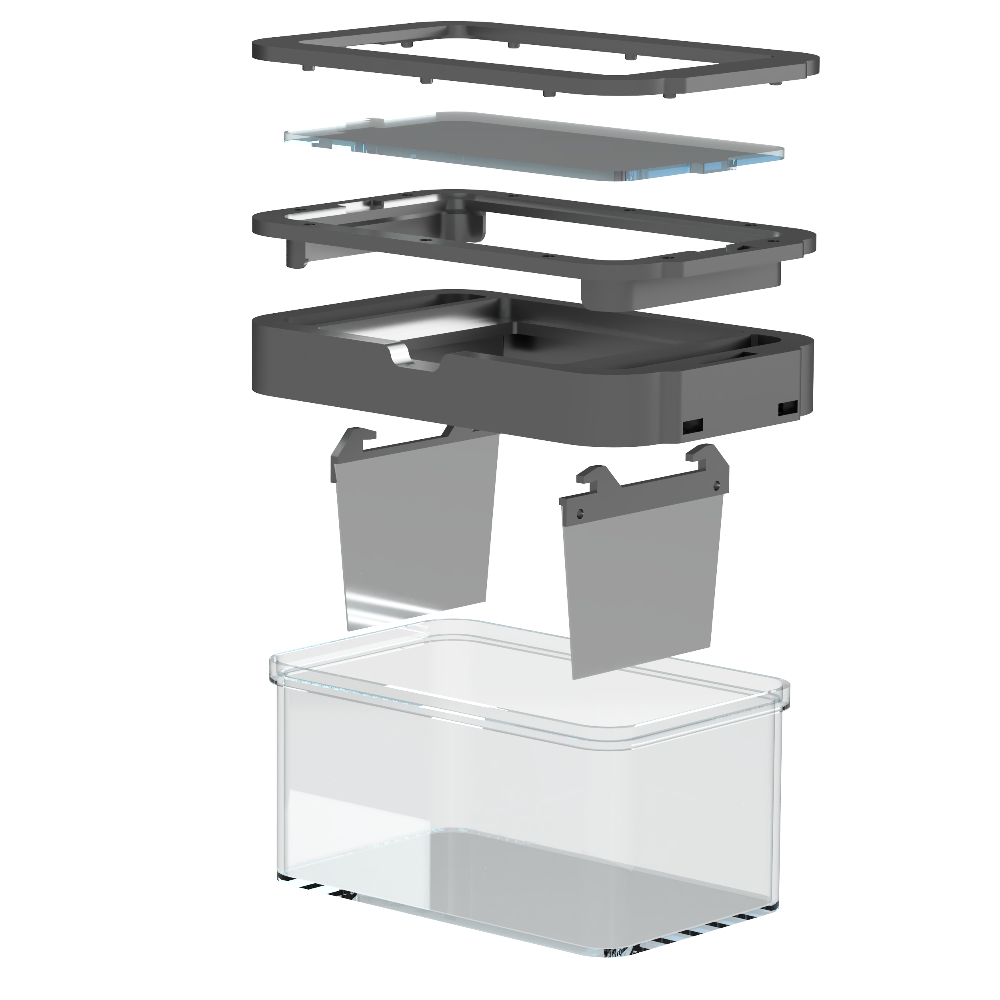

# Zebrafish Electrical Stunning Chamber

This repository contains all information needed to build a chamber for electrical stunning of zebrafish larvae and adults.

The setup is based on a 1.0 L Zebrafish Breeding Tank from TECHNIPLAST and includes a 3D-printable frame and lid, 3D-printable electrode holders, and two electrodes made from 1 mm thick stainless steel.

The chamber can be operated either with a simple power circuit for a limited set of stimulation parameters or with a programmable power source controlled by custom software. The software supports electrical stimulation using multiple parameter sets and enables video recording during experiments. Alternatively, the chamber can be connected to other suitable power sources via banana jacks.

  

  <em>Rendering of the assembled zebrafish electrical stunning chamber.</em>

