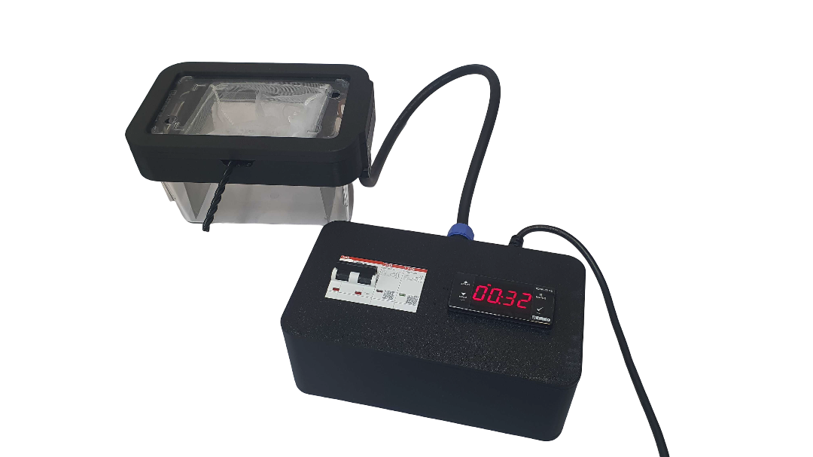
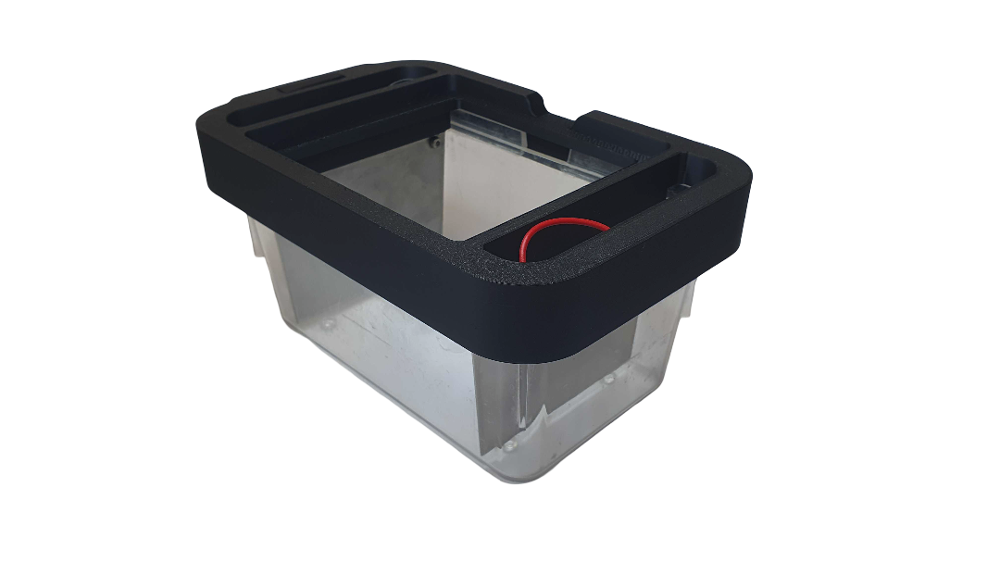

# Modular electrical stunning chamber for zebrafish larvae and adults
 
This repository contains everything needed to build the modular, 3D-printable electrical stunning chamber for zebrafish (*Danio rerio*) described in:
 
> Burkhardt *et al.* (in preparation). *[Title of the manuscript]*. Lab Animal. [DOI will be added upon publication]
 
The chamber is used to kill zebrafish larvae and adult zebrafish humanely by electrical stunning with 230 V / 50 Hz alternating current. It is built around a standard 1.0 L Techniplast breeding tank, and all custom parts can be produced on a desktop 3D printer. The repository provides bills of materials, step-by-step assembly instructions, printable STL files and CAD drawings, so that the device can be rebuilt, adapted and improved by other laboratories.

<p align="center">
  
</p>
<p align="center">
  <em>Rendering of the assembled zebrafish electrical stunning chamber.</em>
</p>
 
---
 
## ⚠️ Safety notice
 
This device operates at **mains voltage (230 V AC)** and applies it directly to water. Incorrect assembly or use can cause **fatal electric shock**.
 
- The electrical installation must be carried out or checked by a **qualified electrician** in accordance with local regulations.
- Always operate the chamber via a residual current device (RCBO).
- Never touch the water, the electrodes or the fish while the circuit is live.
- The use of this device on animals must comply with the applicable animal welfare legislation (e.g. Directive 2010/63/EU) and be approved by your local animal welfare body or competent authority.
The authors provide these files as they are and accept no liability for damage or injury resulting from building or using the device.
 
---
 
## How the chamber works
 
Two stainless-steel plate electrodes are mounted in a 3D-printed tank frame that sits on the rim of the breeding tank. The electrodes can be placed in two positions:
 
| Fish | Electrode position | Electrode distance | Voltage gradient | Medium |
|---|---|---|---|---|
| Larvae | inner (with larval insert) | 4.6 cm | ≈ 50 V/cm | E3 medium |
| Adults | outer | 12.5 cm | ≈ 18.4 V/cm | fish water |
 
A magnet in the tank lid closes a reed switch in the tank frame, so the electrodes can only be energised while the lid is in place. The standard stunning protocol and the validation data are described in the publication.
 
---
 
## Two configurations
 
The chamber is available in two configurations. Both share the same electrodes, electrode mounts and tank lid. They differ in the tank frame and in how the chamber is connected to the mains.
 
### Daily-use configuration (recommended)

<p align="center">
  
</p>
<p align="center">
  <em>Photo of the daily-use configuration, including frame/lid and tank and the control box.</em>
</p>

 
The daily-use frame is connected to a dedicated **control box** with a **4-core cable and a keyed circular connector**, so it cannot be plugged in the wrong way round. The control box contains:
 
- an RCBO (combined residual current and overcurrent protection),
- a digital timer controller that sets the exposure duration,
- two 2-pole modular installation contactors.
The electrodes are energised only when **both** contactors are closed. Contactor 1 closes while the lid is in place (reed switch), and contactor 2 closes while the timer is running. Both contactors switch both poles, so the electrodes are disconnected on all poles as soon as the lid is opened or the exposure time has elapsed. This configuration is intended for **routine use in the fish facility**.

### Experimental configuration

<p align="center">
  
</p>
<p align="center">
  <em>Photo of the experimental-use configuration, including frame/lid.</em>
</p>
 
The experimental frame has **two 4 mm banana jacks** and **one reed switch** that interrupts one of the two conductors. It can be connected flexibly to different power sources and setups, which makes it suitable for developing and testing new stimulation parameters.
 
Because the reed switch interrupts only one pole, the **line conductor (L) must always be connected to the jack wired through the reed switch**. Otherwise the electrodes stay live when the lid is open. This configuration is therefore intended for **experienced users in a controlled experimental setting only**.
 
---
 
## Repository structure
 
Each component has its own folder with all documents needed to buy the parts and build it.
 
```
├── experimental_frame/                      Tank frame with banana jacks (experimental configuration)
├── daily_use_frame/                         Tank frame with circular connector (daily-use configuration)
├── control_box/                             Control box for the daily-use configuration
├── images/                                  Photos used on this page
├── standard_electrical_stunning_protocol    Standard protocol for reliable operation of the daily-use configuration
├── LICENSE
└── README.md
```
 
Each folder contains:
 
| Content | Description |
|---|---|
| `bill_of_materials` | All purchased parts with quantities, suppliers and links |
| `assembly_instructions` | Step-by-step instructions with photos |
| `stl/` | Print-ready files for all 3D-printed parts |
| `cad/` | CAD source files and technical drawings |
 
Each folder contains a complete set of documents.
 
 
## Getting started
 
1. Choose a configuration. For routine use, we recommend the daily-use configuration.
2. Order the parts listed in the bills of materials.
3. Print the 3D-printed parts from the `stl/` folders.
4. Assemble the chamber following the assembly instructions.
5. Have the electrical installation checked by a qualified electrician before first use.
---
 
## Citation
 
If you use or adapt this design, please cite:
 
> Burkhardt *et al.* (in preparation). *[Title]*. Lab Animal. [DOI]
 
---
 
## Contact
 
Arrenberg Lab, Werner Reichardt Centre for Integrative Neuroscience (CIN), University of Tübingen, Germany
<p> Dr. David-Samuel Burkhardt, david-samuel.burkhardt[at]uni-tuebingen.de </p>
<p> Prof. Dr. Aristides Arrenberg, aristides.arrenberg[at]uni-tuebingen.de </p>

